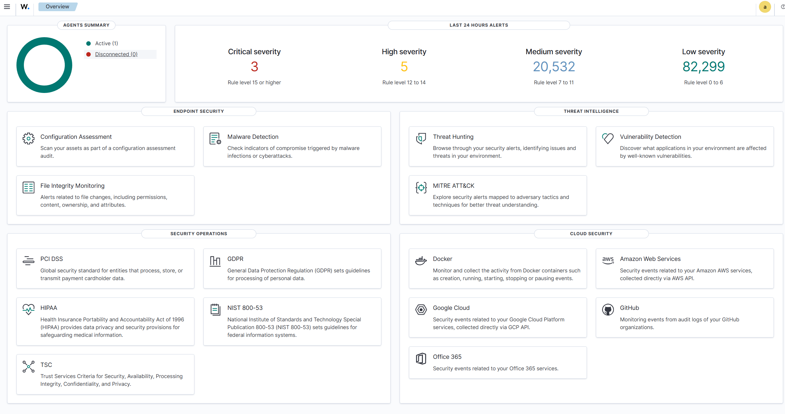
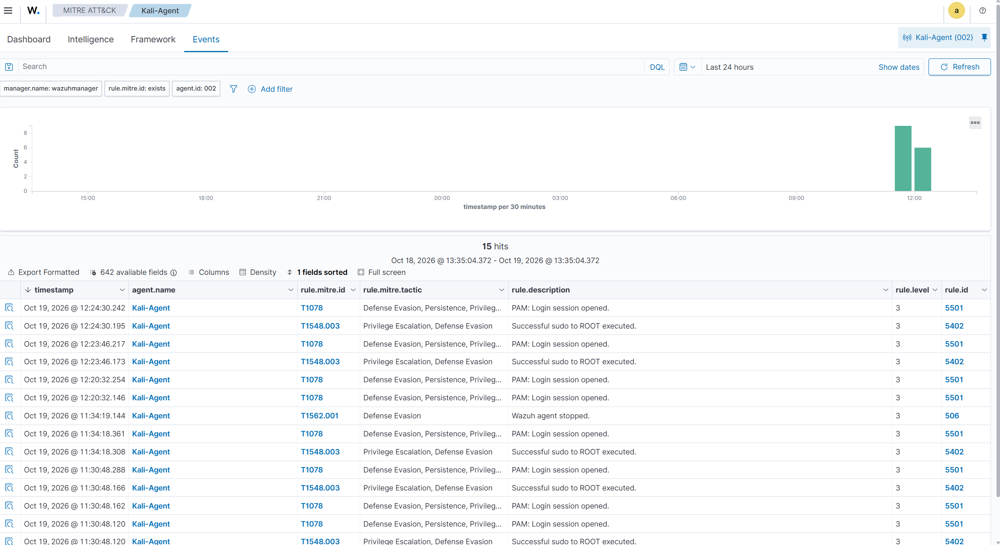
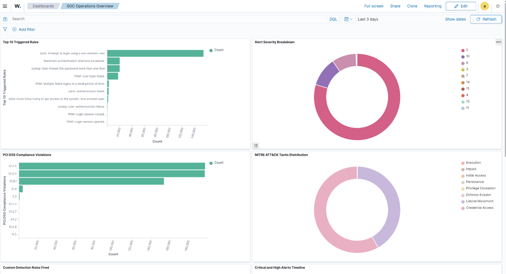
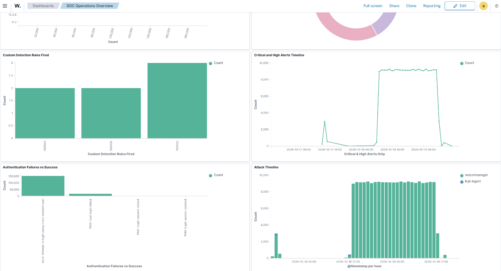
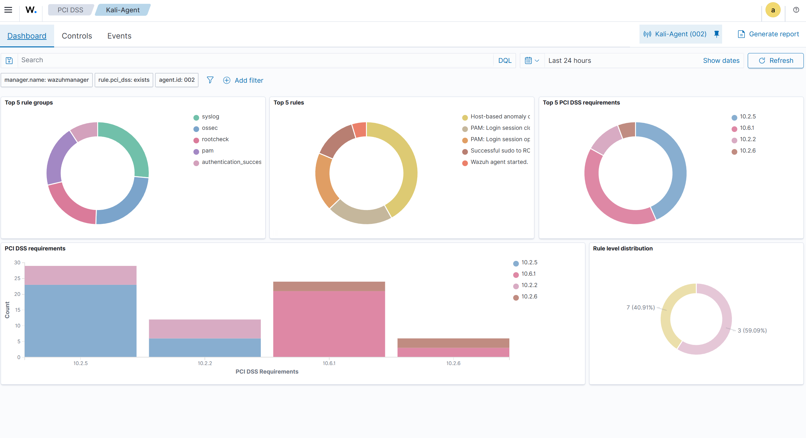

# Adversary Simulation & Detection Engineering Lab
### Wazuh SIEM | MITRE ATT&CK | Custom Rules | Threat Hunting

## Overview

This lab simulates a real-world adversarial attack scenario against a 
monitored endpoint, with full detection, investigation, and response 
documentation. Built from scratch using VirtualBox, Ubuntu Server 22.04, 
and Kali Linux, the environment replicates a SOC analyst's day-to-day 
workflow — from initial alert triage to threat hunting and custom 
detection rule development.

The lab goes beyond basic SIEM setup. I deployed Wazuh as a full XDR 
platform, executed a multi-stage attack chain against the monitored 
server, wrote custom detection rules to close gaps in default coverage, 
built a custom SOC dashboard, and conducted structured threat hunts 
using DQL queries mapped to MITRE ATT&CK tactics.

---

## Environment

| Component | Details |
|-----------|---------|
| **Host OS** | Windows 11 |
| **Hypervisor** | VirtualBox 7.2 |
| **SIEM** | Wazuh 4.12.0 (Manager + Indexer + Dashboard) |
| **Server** | Ubuntu Server 22.04 LTS — 192.168.56.102 |
| **Attacker** | Kali Linux 2026.2 — 192.168.56.103 |
| **Network** | VirtualBox Host-Only (192.168.56.0/24) |

---

## Attack Chain Executed

The attack followed a realistic kill chain across 8 stages:

| Stage | Technique | Tool | MITRE ID |
|-------|-----------|------|----------|
| Reconnaissance | Stealth SYN scan | nmap -sS -T2 | T1595.001 |
| Service Discovery | Version + OS fingerprinting | nmap -sV -sC -O | T1046 |
| Vulnerability Assessment | CVE scanning | nmap --script=vuln | T1595 |
| Web Enumeration | Directory + parameter fuzzing | nikto, dirb, wfuzz | T1083 |
| Credential Attack | SSH brute force | Hydra | T1110.001 |
| Persistence | Backdoor user creation | useradd | T1136.001 |
| Defense Evasion | Log file clearing | truncate | T1070.002 |
| Credential Access | Shadow file harvesting | cat /etc/shadow | T1003.008 |

---

## Key Findings

### Vulnerabilities Discovered
- **CVE-2007-6750** — Slowloris DoS attack: LIKELY VULNERABLE
- **HTTP Verb Tampering** — Authentication bypass: VULNERABLE (Exploitable)
- **SSL Misconfiguration** — Certificate SAN limited to 127.0.0.1
- **Server Identity Exposure** — osd-name: wazuhmanager leaked in headers
- **Missing Security Headers** — CSP, HSTS, X-Content-Type-Options absent
- **201 Vulnerabilities** on endpoint — 4 Critical, 89 High, 88 Medium

### Detection Results
- **173,703** authentication failure events detected
- **213,320** total security events over 48-hour period
- **6 custom detection rules** deployed and validated
- **4 MITRE ATT&CK tactics** detected: Defense Evasion, 
  Privilege Escalation, Persistence, Initial Access

---

## Custom Detection Rules

Six custom rules were written to close gaps in Wazuh's default 
detection coverage:

| Rule ID | Level | Description | MITRE |
|---------|-------|-------------|-------|
| 100001 | 10 | Stealth port scan detection | T1595.001 |
| 100002 | 14 | /etc/shadow access — credential harvesting | T1003.008 |
| 100003 | 12 | Malicious cron job creation | T1053.003 |
| 100004 | 13 | Log file cleared via truncate | T1070.002 |
| 100005 | 14 | SSH brute force threshold exceeded | T1110.001 |
| 100006 | 15 | Backdoor user account created | T1136.001 |

---

## Threat Hunting

Three structured threat hunts were conducted using DQL queries 
against the Wazuh indexer:

| Hunt | Query | Findings |
|------|-------|----------|
| Brute Force Hunt | `data.srcip: "192.168.56.103" AND rule.groups: "authentication_failed"` | 173,703 hits |
| Persistence Hunt | `rule.mitre.tactic: "Persistence"` | 106 hits, Rule 100006 fired |
| Defense Evasion Hunt | `rule.mitre.tactic: "Defense Evasion"` | 189 hits, Rule 100004 fired |

---

## MITRE ATT&CK Coverage

| Tactic | Techniques Detected |
|--------|-------------------|
| Defense Evasion | T1070.002, T1562.001, T1078 |
| Privilege Escalation | T1548.003 |
| Persistence | T1136.001, T1053.003 |
| Initial Access | T1078 |
| Credential Access | T1003.008, T1110.001 |

---

## Custom SOC Dashboard

A custom dashboard was built in the Wazuh OpenSearch interface 
with 8 visualizations:

- Attack Timeline by Agent
- Alert Severity Breakdown
- Top 10 Triggered Rules
- MITRE ATT&CK Tactic Distribution
- Authentication Failures vs Success
- Custom Detection Rules Fired
- Critical and High Alerts Timeline
- PCI DSS Compliance Violations

---

## Compliance Mapping

Every alert was automatically mapped to compliance frameworks:

| Framework | Controls Triggered |
|-----------|-------------------|
| **PCI DSS** | 10.2.5, 10.6.1, 10.2.2, 10.2.6, 8.1.2 |
| **GDPR** | IV_35.7.d, IV_32.2 |
| **HIPAA** | 164.312.b, 164.312.a.2.I, 164.312.c.1 |
| **NIST 800-53** | AU.14, AC.7, AC.2, IA.4, SI.7 |

---

## Repository Structure

wazuh-siem-detection-lab/
├── README.md
├── architecture/
│ └── network-diagram.png
├── setup/
│ ├── 01-virtualbox-setup.md
│ ├── 02-ubuntu-server-install.md
│ ├── 03-wazuh-manager-install.md
│ └── 04-kali-agent-deploy.md
├── attack-simulation/
│ ├── 01-reconnaissance.md
│ ├── 02-credential-attacks.md
│ ├── 03-web-attacks.md
│ ├── 04-fim-tampering.md
│ ├── 05-persistence.md
│ └── 06-log-tampering.md
├── detection-engineering/
│ ├── custom-rules/
│ │ └── local_rules.xml
│ └── rule-analysis.md
├── threat-hunting/
│ ├── hunting-queries.md
│ └── hunting-findings.md
├── incident-response/
│ ├── ir-playbook.md
│ └── incident-report.md
├── mitre-attack/
│ └── attack-mapping.md
├── screenshots/
└── lessons-learned/
└── lessons-learned.md

---

## Skills Demonstrated

- SIEM deployment and configuration (Wazuh 4.12)
- Detection rule engineering (XML, MITRE mapping)
- Adversary simulation (8 attack techniques)
- Threat hunting (DQL queries, tactic-based investigation)
- Vulnerability assessment (CVE identification, risk analysis)
- Incident response (alert triage, evidence collection)
- Compliance monitoring (PCI DSS, GDPR, HIPAA, NIST)
- Custom dashboard development (OpenSearch visualizations)
- Linux administration (Ubuntu Server, netplan, LVM)

---

## Tools Used

`Wazuh 4.12` `Kali Linux` `nmap` `Hydra` `Nikto` `Dirb` 
`Wfuzz` `VirtualBox` `Ubuntu Server 22.04` `OpenSSH` 
`OpenSearch Dashboards`