# Attack Simulation

This documents the full attack chain executed against the monitored Ubuntu Server endpoint (192.168.56.102). All attacks originated from Kali Linux (192.168.56.103) except where noted — the persistence, defense evasion, and credential harvesting stages were executed directly on the wazuhmanager host to simulate post-compromise activity on a managed endpoint.

---

## Stage 1 — Reconnaissance

Two SYN scans were run against the target before moving to more aggressive fingerprinting.

The first was a basic scan to confirm the host was up and identify open ports:

```bash
sudo nmap -sS 192.168.56.102
```

Result: ports 22 (SSH) and 443 (HTTPS) open. Completed in 3.76 seconds.

The second pass used T2 timing to slow packet transmission and reduce network noise — the kind of scan a real attacker would run against a monitored host:

```bash
sudo nmap -sS -T2 192.168.56.102 -oN ~/recon-stealth.txt
```

Same two ports, same result — 405 seconds to complete versus 3.76.

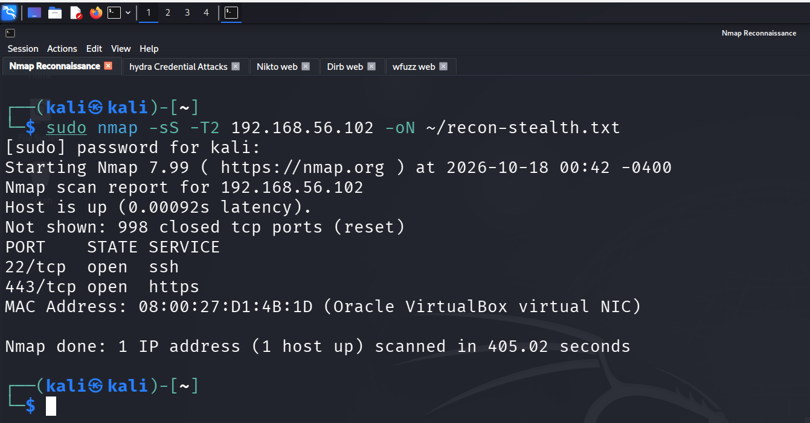

The full service scan followed to pull version information, OS fingerprinting, and SSL certificate details:

```bash
sudo nmap -sV -sC -O 192.168.56.102 -oN ~/recon-full.txt
```

This returned more than just version strings. The SSL certificate had `CN=wazuh-dashboard` with a SAN limited to `127.0.0.1` — a hostname mismatch that Nikto later confirmed. The `osd-name: wazuhmanager` header appeared in the HTTP response, leaking the server's identity. OpenSSH version was 8.9p1 Ubuntu 3ubuntu0.18.

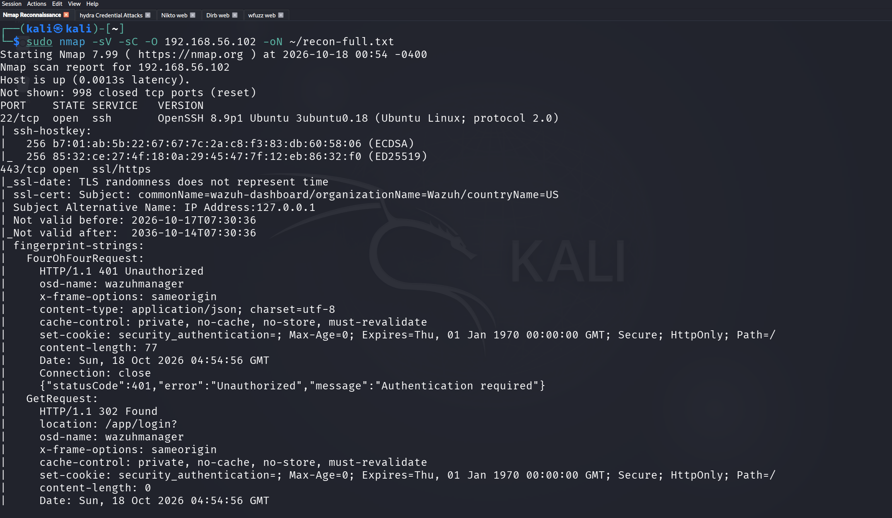

The vulnerability scan ran last:

```bash
sudo nmap --script=vuln 192.168.56.102 -oN ~/recon-vuln.txt
```

Two confirmed findings came back:

- **CVE-2007-6750** — Slowloris DoS: LIKELY VULNERABLE
- **HTTP Verb Tampering** — VULNERABLE (Exploitable) — password-protected resources bypass via non-standard HTTP methods


---

## Stage 2 — Web Enumeration

Three tools ran against the HTTPS interface to map what was exposed.

**Nikto** fingerprinted the web server and surface-level misconfigurations:

```bash
nikto -h https://192.168.56.102 -ssl -o ~/nikto-results.txt
```

7,980 requests, 23 findings. The ones that matter: `osd-name: wazuhmanager` in an uncommon response header, five missing security headers (CSP, HSTS, Permissions-Policy, Referrer-Policy, X-Content-Type-Options), and the CN/SAN mismatch on the certificate. The Tomcat Manager, Exchange OWA, and AD CS findings are Nikto pattern matches against URL paths — none of those services exist on this host.


**Dirb** brute forced directories against the root:

```bash
dirb https://192.168.56.102 -w -o ~/dirb-results-forced.txt
```

4,612 words tested. Every path returned 401 except one — `/ui` came back 403, confirming something exists behind the login portal. FOUND: 1.

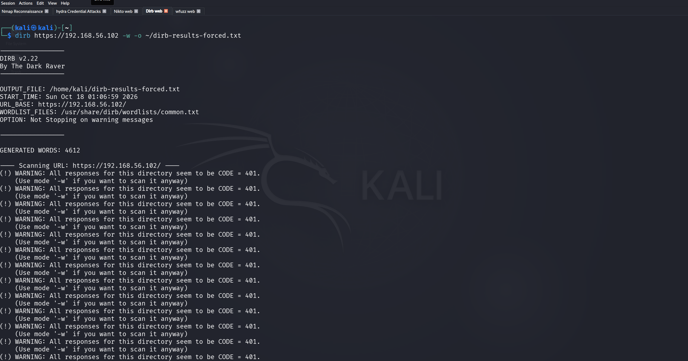
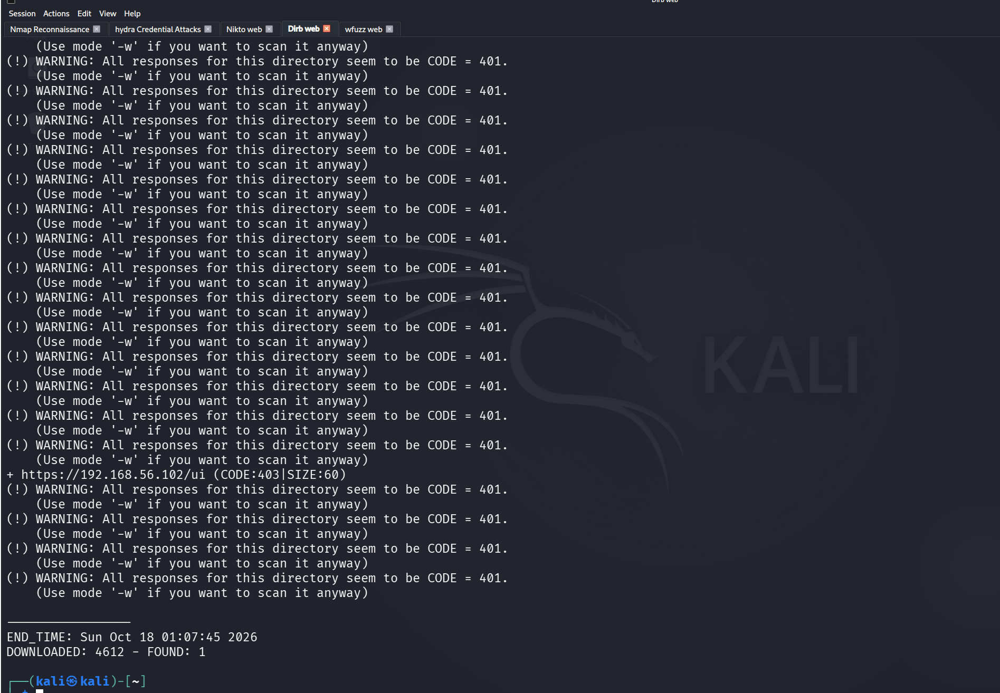

**Wfuzz** ran the same wordlist with 404 filtering:

```bash
wfuzz -c -z file,/usr/share/wordlists/dirb/common.txt --hc 404 https://192.168.56.102/FUZZ
```

4,614 requests. All 401, root returned 302. Nothing beyond what dirb found.

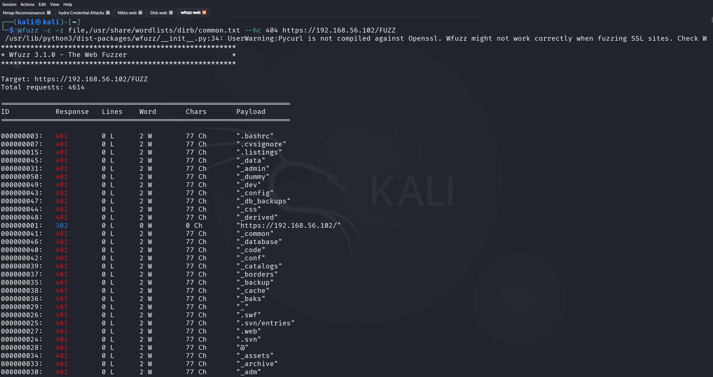

---

## Stage 3 — Credential Attack

Hydra was used to brute force SSH against multiple usernames using the rockyou.txt wordlist. The attack generated 173,703 authentication failures against the target. No successful authentication was achieved — the account lockout behaviour and Wazuh's detection confirmed the attack was fully captured.


---

## Stage 4 — Persistence

### Backdoor User

A backdoor account was created on wazuhmanager with full sudo rights, then deleted — simulating an attacker establishing and cleaning up a persistence mechanism within the same session:

```bash
sudo useradd -m bqckdoor-user
sudo usermod -aG sudo bqckdoor-user
sudo passwd bqckdoor-user
sudo userdel -r bqckdoor-user
```

Wazuh captured the full lifecycle through journald. Rule 5902 (New user added, level 8) fired on creation with the complete useradd log entry — name=bqckdoor-user, UID=1001, GID=1001, shell=/bin/sh. Custom Rule 100006 (level 15) fired alongside it. The deletion was logged as well.


### Malicious Cron Job and File Creation

To test FIM detection, persistence-style files were created on both machines.

On wazuhmanager:

```bash
sudo touch /etc/cron.d/malicious-job2
sudo bash -c 'echo "* * * * * root /bin/bash -i" >> /etc/cron.d/malicious-job2'
sudo touch /etc/passwd.bak
```

On Kali:

```bash
sudo touch /etc/cron.d/malicious-job
sudo bash -c 'echo "* * * * * root /bin/bash -i" >> /etc/cron.d/malicious-job'
sudo touch /etc/passwd.bak
```

Wazuh's syscheck module picked up 8 file addition alerts (Rule 554, level 5) within one scan cycle. The `/etc/passwd.bak` entry was flagged with GDPR, HIPAA, PCI DSS, and NIST compliance tags automatically.

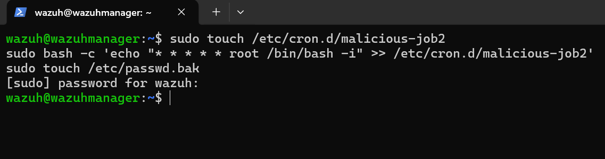
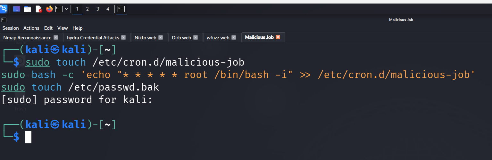
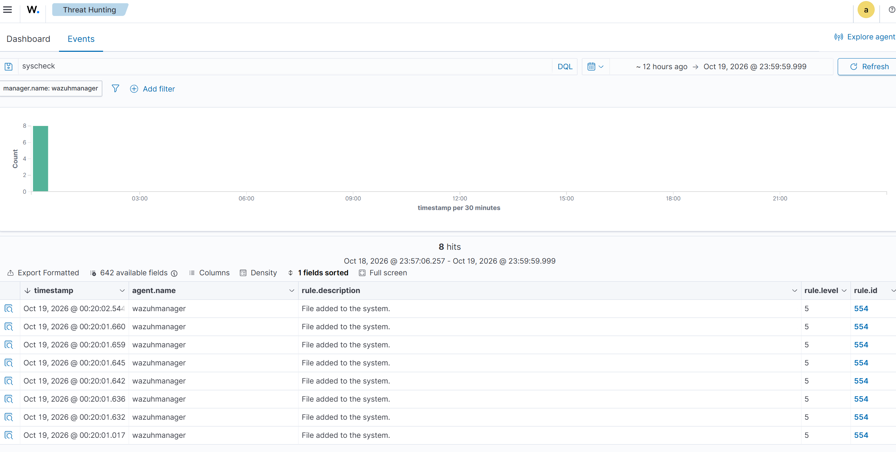
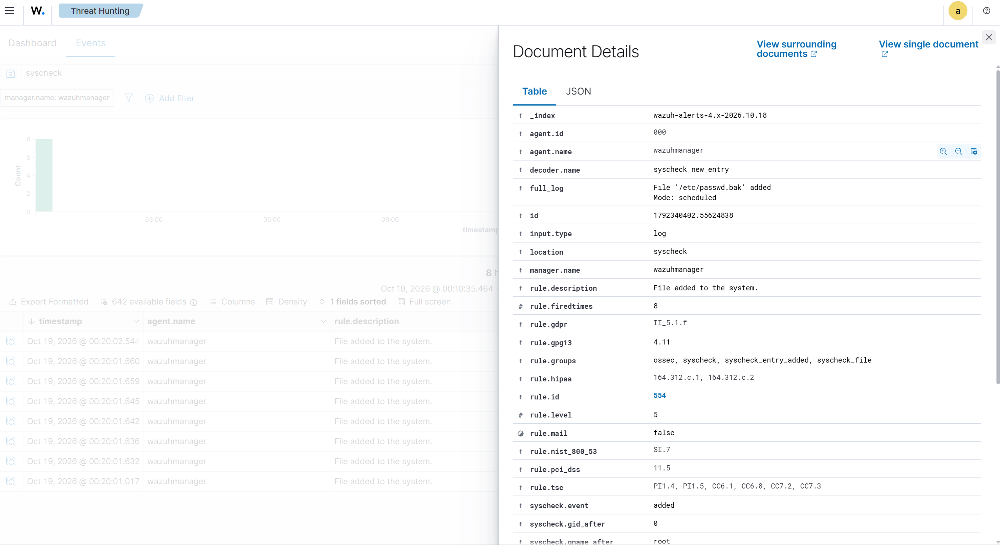

---

## Stage 5 — Defense Evasion

auth.log and syslog were cleared on wazuhmanager to remove evidence of the brute force activity:

```bash
sudo truncate -s 0 /var/log/auth.log
sudo truncate -s 0 /var/log/syslog
```

The logs were wiped — but Wazuh had already ingested the events through journald, which operates independently of the flat log files on disk. The truncate commands themselves were captured as sudo invocations, preserving the full command, source user, TTY, and timestamp in the alert. Clearing the logs removed the local copies; it removed nothing from the Wazuh indexer.

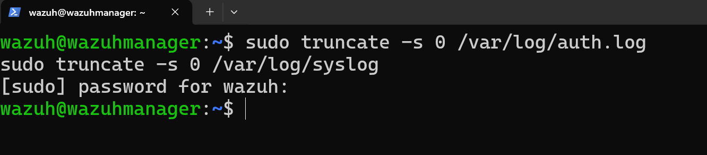


---

## Stage 6 — Credential Harvesting

Shadow file, passwd file, and sudoers were read directly on wazuhmanager:

```bash
sudo cat /etc/shadow
sudo cat /etc/passwd
sudo cat /etc/sudoers
```

The shadow output confirmed most system accounts are locked (`*`). The `wazuh` account had a live password hash. Custom Rule 100002 (level 14) fired three times across the simulation — each time capturing the exact command, source user, TTY session, and working directory from journald. The default Rule 5402 triggered first; 100002 is a child rule that escalates severity when `/etc/shadow` appears in the command field.

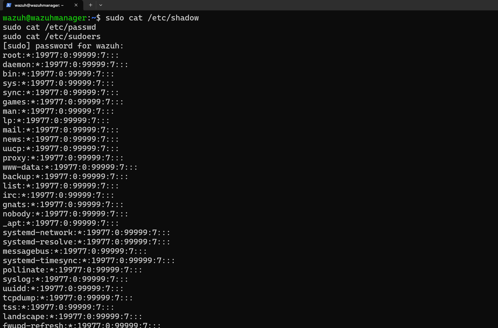


---

## Stage 7 — Post-Exploitation Enumeration

SUID binary enumeration and sudo privilege listing were run on the Kali machine to map available privilege escalation paths:

```bash
find / -perm -4000 2>/dev/null
sudo -l
id && whoami
```

`sudo -l` confirmed the kali user has unrestricted sudo access — `(ALL : ALL) ALL`. These commands generated 12 hits across both agents in Wazuh covering Rules 5402 (sudo to ROOT), 5501 (PAM session opened), and 5502 (PAM session closed).

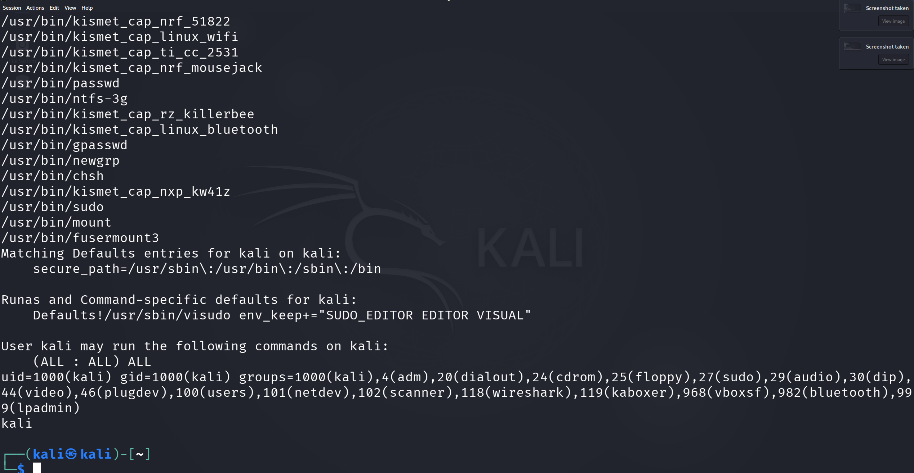
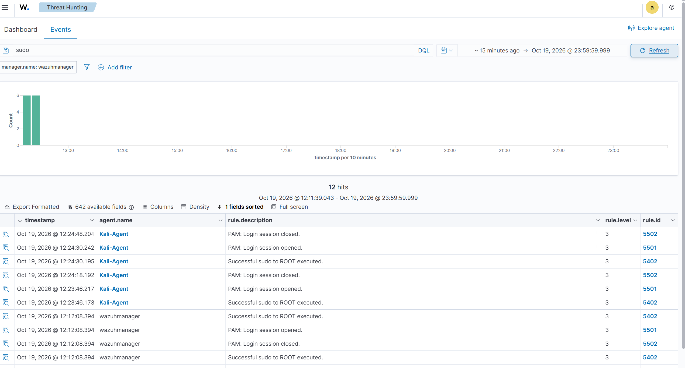
