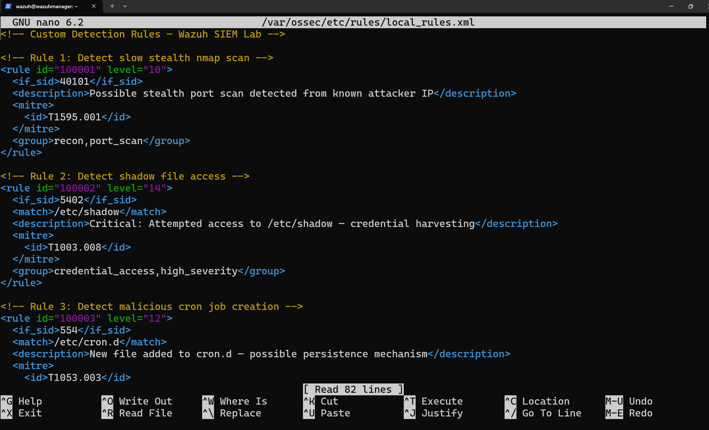
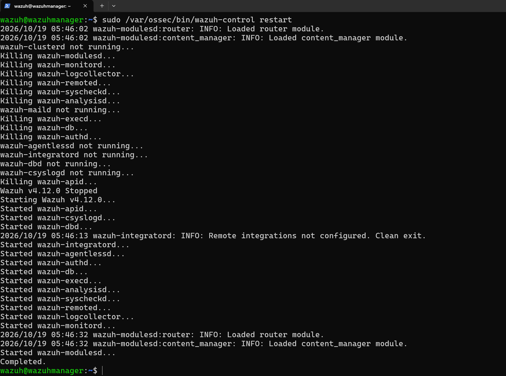
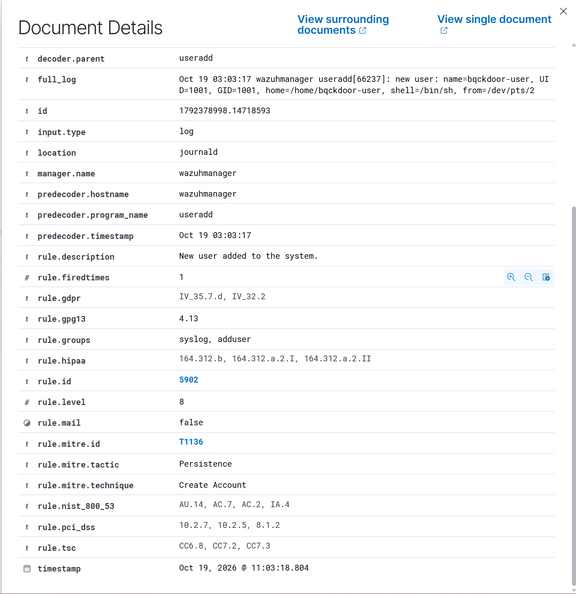

# Detection Engineering

Five custom rules were written and deployed to `/var/ossec/etc/rules/local_rules.xml` on the Wazuh manager. The goal wasn't to replace default rules, it was to extend them where they fell short: wrong severity level, missing context, or no coverage at all for specific techniques used in the simulation.

All rules follow Wazuh's chaining model, they build on existing rule SIDs rather than trying to parse raw logs independently. Each one was validated by running the attack technique and confirming the alert fired in the Wazuh indexer.

---

## Rule File

The rules live at `/var/ossec/etc/rules/local_rules.xml` on the Wazuh manager. After each edit, a full service restart was required to load the changes:

```bash
sudo /var/ossec/bin/wazuh-control restart
```

All services cycled clean on Wazuh v4.12.0.




---

## The Rules

### Rule 100001 — Stealth Port Scan Detection
**Level:** 10 | **MITRE:** T1595.001

```xml
<rule id="100001" level="10">
  <if_sid>40101</if_sid>
  <description>Possible stealth port scan detected from known attacker IP</description>
  <mitre>
    <id>T1595.001</id>
  </mitre>
</rule>
```

Wazuh's default Rule 40101 detects port scans but fires at level 6 with no MITRE mapping. This rule chains off 40101 and raises the severity to 10, adding the T1595.001 tag so the event surfaces correctly in the MITRE ATT&CK module. Dependent on the parent rule firing, which requires the scan to cross Wazuh's packet threshold.

---

### Rule 100002 — Shadow File Access
**Level:** 14 | **MITRE:** T1003.008

```xml
<rule id="100002" level="14">
  <if_sid>5402</if_sid>
  <match>/etc/shadow</match>
  <description>Critical: Attempted access to /etc/shadow — credential harvesting</description>
  <mitre>
    <id>T1003.008</id>
  </mitre>
</rule>
```

The default Rule 5402 fires for any successful sudo execution at level 3 — far too low for shadow file access, and with no distinction between routine admin tasks and credential harvesting. This rule chains off 5402 and matches on `/etc/shadow` in the command field, raising severity to 14 and mapping it to T1003.008. It fired three times during the simulation.


---

### Rule 100003 — Malicious Cron Job Creation
**Level:** 12 | **MITRE:** T1053.003

```xml
<rule id="100003" level="12">
  <if_sid>554</if_sid>
  <match>/etc/cron.d</match>
  <description>New file added to cron.d — possible persistence mechanism</description>
  <mitre>
    <id>T1053.003</id>
  </mitre>
</rule>
```

Wazuh's FIM Rule 554 fires on any file addition across monitored directories at level 5 with no context on what directory was modified. This rule chains off 554 and matches specifically on `/etc/cron.d`, raising severity to 12 and tagging it as a persistence technique. The FIM scan interval means there's a delay between file creation and detection — covered under lessons learned in the incident report.

---

### Rule 100004 — Log File Cleared via Truncate
**Level:** 13 | **MITRE:** T1070.002

```xml
<rule id="100004" level="13">
  <if_sid>5402</if_sid>
  <match>truncate</match>
  <description>Critical: Log file cleared using truncate — attacker covering tracks</description>
  <mitre>
    <id>T1070.002</id>
  </mitre>
</rule>
```

Like Rule 100002, the default 5402 catches the sudo execution but doesn't distinguish log clearing from any other privileged command. This rule chains off 5402 and matches on `truncate` in the command field. It fired twice — once for auth.log and once for syslog, captured through journald even after the files were wiped.


---

### Rule 100006 — Backdoor User Account Created
**Level:** 15 | **MITRE:** T1136.001

```xml
<rule id="100006" level="15">
  <if_sid>5902</if_sid>
  <match>backdoor</match>
  <description>CRITICAL: Backdoor user account created on system</description>
  <mitre>
    <id>T1136.001</id>
  </mitre>
</rule>
```

The default Rule 5902 (New user added to the system) fires at level 8 — medium severity, easy to miss in a noisy environment. This rule chains off 5902 and matches on `backdoor` in the log entry, raising severity to level 15, the highest in Wazuh's scale. It was confirmed in the Persistence threat hunt (106 hits under `rule.mitre.tactic: "Persistence"`).



---

## Validation

After deployment, a DQL query was run against the Wazuh indexer to confirm rules were firing:

```
rule.id: 100001 OR rule.id: 100002 OR rule.id: 100003 OR rule.id: 100004 OR rule.id: 100006
```

5 hits returned within the last 24 hours — Rule 100002 (3 hits) and Rule 100004 (2 hits) visible at levels 14 and 13 respectively. Rule 100006 (level 15) was confirmed separately through the Persistence tactic hunt. Rules 100001 and 100003 fired under different query windows during their respective test phases.


| **Rule** | **Fired** | **Confirmed Via** |
|----------|-----------|-------------------|
| 100001 — Stealth scan | Partial | Parent rule 40101 dependent |
| 100002 — Shadow access | Yes — 3 hits | DQL + credential harvest test |
| 100003 — Cron job creation | Yes | FIM syscheck alerts |
| 100004 — Log tampering | Yes — 2 hits | DQL + defense evasion test |
| 100006 — Backdoor user | Yes | Persistence tactic hunt |
