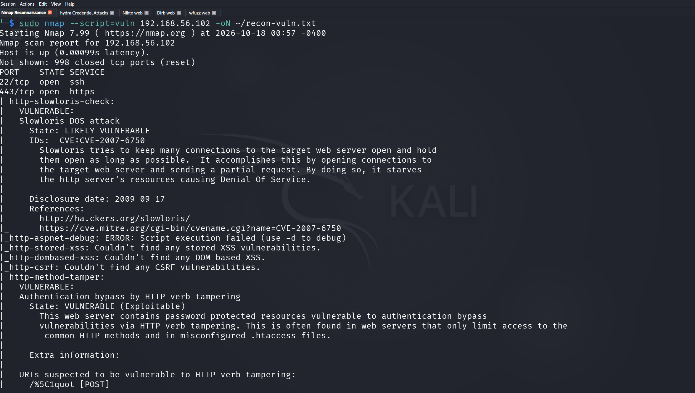
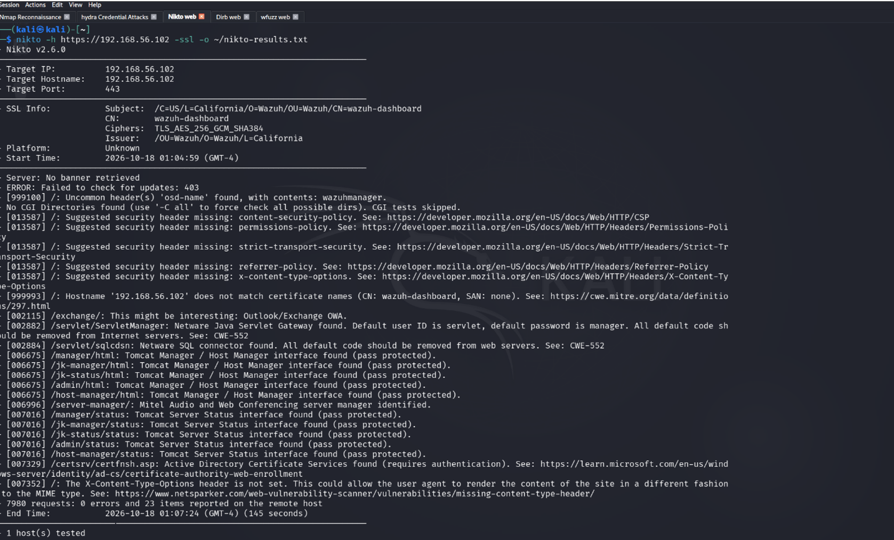
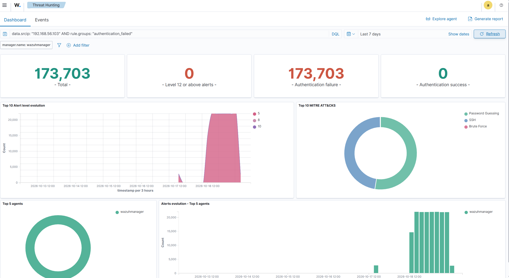
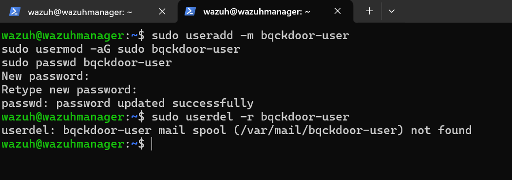
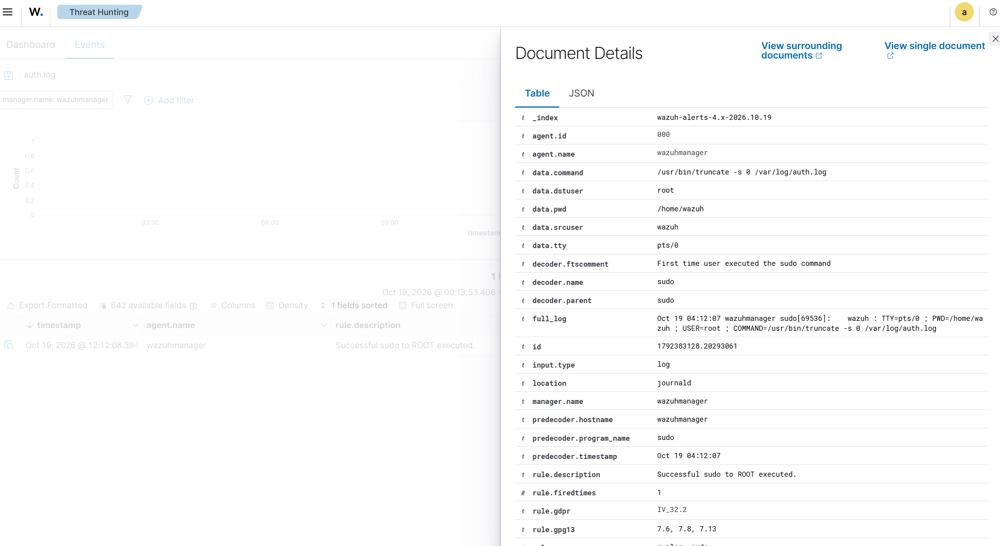
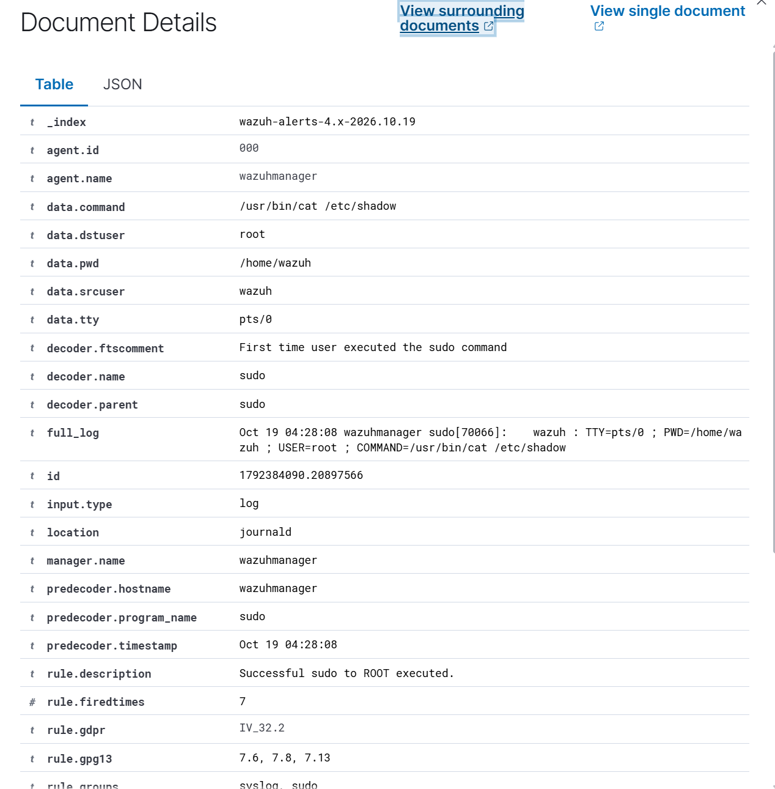
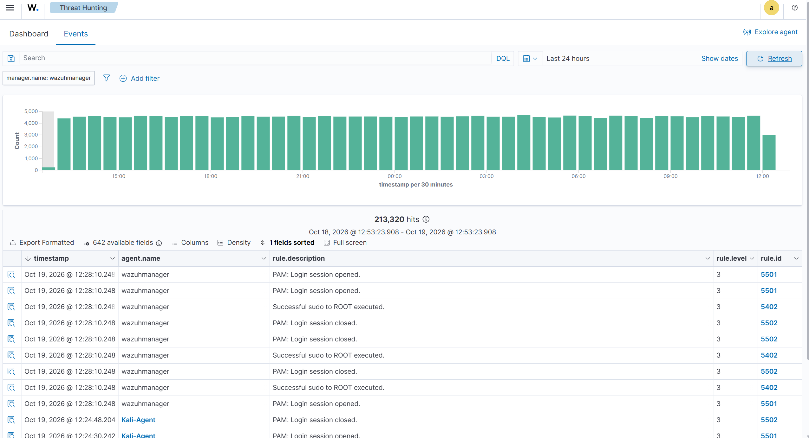
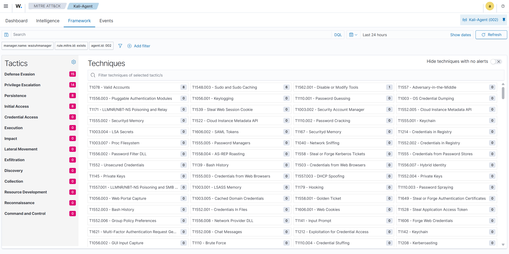
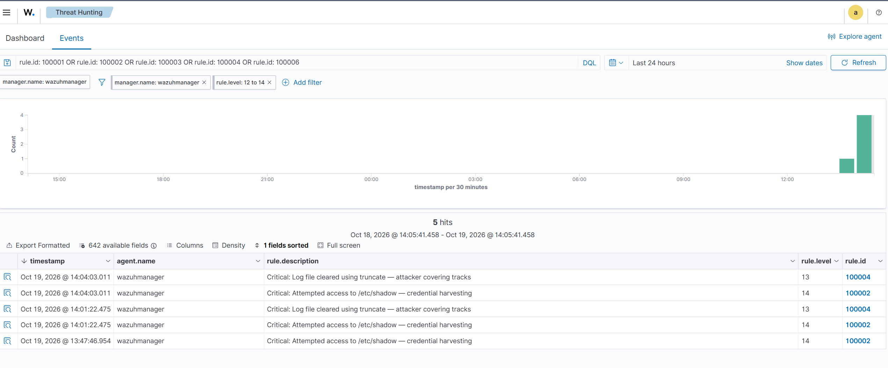

# Incident Report
## Security Incident: Multi-Stage Adversarial Attack Against Monitored Endpoint

**Report ID:** IR-2026-001  
**Date:** October 19, 2026  
**Severity:** Critical  
**Status:** Completed — Controlled Lab Simulation  
**Analyst:** SOC Detection Engineering Lab  

---

## Executive Summary

A controlled adversarial simulation was conducted against a monitored Ubuntu Server endpoint (192.168.56.102) running Wazuh SIEM/XDR 4.12.0. The attack chain originated from Kali Linux (192.168.56.103) for reconnaissance, web enumeration, and credential attacks. Post-compromise stages — persistence, defense evasion, and credential harvesting — were executed directly on the wazuhmanager host to simulate an attacker operating on a managed endpoint after gaining access.

Wazuh detected and logged all attack stages. Custom detection rules written specifically for this environment identified gaps in default coverage — including shadow file access and log tampering — which default rules alone would have missed at the appropriate severity level.

A total of **213,320 security events** were generated over the simulation period, with **173,703 authentication failures** attributed to SSH brute force activity from 192.168.56.103.

---

## Incident Timeline

| **Date** | **Event** |
|----------|-----------|
| Oct 17, 2026 | Initial reconnaissance — basic SYN scan, T2 stealth scan, service fingerprinting, vulnerability scan |
| Oct 17, 2026 | Web enumeration — nikto, dirb, wfuzz executed against target |
| Oct 18, 2026 | SSH brute force initiated — Hydra with multiple usernames and rockyou.txt wordlist |
| Oct 18, 2026 | 173,703 authentication failures recorded in Wazuh |
| Oct 19, 2026 | Malicious cron jobs and passwd.bak created on both machines — FIM alerts triggered |
| Oct 19, 2026 | Backdoor user (bqckdoor-user) created on wazuhmanager — Rule 100006 fired |
| Oct 19, 2026 | Backdoor user deleted — Rule 5902 full lifecycle captured |
| Oct 19, 2026 | auth.log and syslog cleared via truncate on wazuhmanager — Rule 100004 fired |
| Oct 19, 2026 | /etc/shadow, /etc/passwd, /etc/sudoers accessed on wazuhmanager — Rule 100002 fired |
| Oct 19, 2026 | SUID enumeration and sudo privilege listing performed on Kali |

---

## Attack Narrative

### Stage 1 — Reconnaissance

Two SYN scans were run against the target before moving to more aggressive fingerprinting. The first was a basic scan to confirm the host was up and identify open ports:

```bash
sudo nmap -sS 192.168.56.102
```

Ports 22 (SSH) and 443 (HTTPS) came back open in 3.76 seconds. The second pass used T2 timing to slow packet transmission and reduce the scan's network footprint:

```bash
sudo nmap -sS -T2 192.168.56.102 -oN ~/recon-stealth.txt
```

Same result — 405 seconds to complete. A full service scan followed, revealing OpenSSH 8.9p1 and the `osd-name: wazuhmanager` response header, which confirmed the target was a Wazuh deployment. The SSL certificate had a SAN limited to `127.0.0.1` with a CN/hostname mismatch.

A vulnerability scan identified two exploitable issues:
- **CVE-2007-6750** — Slowloris DoS: LIKELY VULNERABLE
- **HTTP Verb Tampering** — Authentication bypass: VULNERABLE (Exploitable)



### Stage 2 — Web Enumeration

Nikto returned 23 findings across 7,980 requests — five missing security headers (CSP, HSTS, Permissions-Policy, Referrer-Policy, X-Content-Type-Options) and the `osd-name: wazuhmanager` header confirmed again. Dirb tested 4,612 paths with all returning 401 except `/ui`, which returned 403 — indicating an interface exists behind the login portal. Wfuzz confirmed the same across 4,614 requests with no additional findings.



### Stage 3 — Credential Attack

Hydra was used to execute an SSH brute force attack against multiple usernames using the rockyou.txt wordlist. 173,703 authentication failures were generated from 192.168.56.103. No successful authentication was achieved — the attack volume triggered multiple Wazuh alert rules and was fully captured in the indexer.



### Stage 4 — Persistence

To test FIM detection, malicious cron job files and a passwd.bak were created on both machines. On wazuhmanager: `malicious-job2` with a reverse shell payload written to `/etc/cron.d/` and `/etc/passwd.bak`. On Kali: the same pattern using `malicious-job`. Wazuh's syscheck module generated 8 file addition alerts (Rule 554, level 5) within one scan cycle, with `/etc/passwd.bak` automatically tagged against GDPR, HIPAA, PCI DSS, and NIST controls.

A backdoor user account was then created on wazuhmanager with full sudo rights and subsequently deleted:

```bash
sudo useradd -m bqckdoor-user
sudo usermod -aG sudo bqckdoor-user
sudo passwd bqckdoor-user
sudo userdel -r bqckdoor-user
```

Rule 5902 (New user added, level 8) captured the full useradd log entry — name=bqckdoor-user, UID=1001, GID=1001, shell=/bin/sh — via journald. Custom Rule 100006 (level 15) fired alongside it. The deletion was also logged, giving a complete account lifecycle in the indexer.



### Stage 5 — Defense Evasion

auth.log and syslog were cleared directly on wazuhmanager to remove evidence of the brute force activity:

```bash
sudo truncate -s 0 /var/log/auth.log
sudo truncate -s 0 /var/log/syslog
```

Both files were wiped. Wazuh's journald-based collection had already ingested the events and captured the truncate commands themselves — full sudo invocation with timestamp, source user (wazuh), TTY (pts/0), and target command preserved in the alert. Clearing the log files removed the local copies; it removed nothing from the Wazuh indexer.



### Stage 6 — Credential Harvesting

Shadow file, passwd, and sudoers were read directly on wazuhmanager:

```bash
sudo cat /etc/shadow
sudo cat /etc/passwd
sudo cat /etc/sudoers
```

The shadow file output confirmed most system accounts are locked (`*`). The `wazuh` account had a live password hash. Custom Rule 100002 (level 14) fired three times across the simulation — each time capturing the exact command, source user, TTY session, and working directory from journald. The default Rule 5402 triggered first; Rule 100002 fires as a child rule when `/etc/shadow` appears in the command field, escalating from level 3 to level 14.



### Stage 7 — Post-Exploitation Enumeration

SUID binary enumeration and sudo privilege listing were performed on the Kali machine to map available escalation paths on the attacker's own system:

```bash
find / -perm -4000 2>/dev/null
sudo -l
id && whoami
```

`sudo -l` confirmed the kali user has unrestricted sudo access — `(ALL : ALL) ALL`. These commands generated 12 hits across both agents in Wazuh covering Rules 5402 (sudo to ROOT), 5501 (PAM session opened), and 5502 (PAM session closed).

---

## Vulnerabilities Identified

| **ID** | **Vulnerability** | **Severity** | **Status** |
|--------|------------------|--------------|------------|
| CVE-2007-6750 | Slowloris DoS | High | Unpatched |
| — | HTTP Verb Tampering | High | Unpatched |
| — | SSL Certificate Misconfiguration | Medium | Unpatched |
| — | Server Identity Disclosure (osd-name header) | Medium | Unpatched |
| — | Missing HTTP Security Headers (5) | Medium | Unpatched |
| — | 201 package vulnerabilities (Kali agent) | Critical–Low | Unpatched |

---

## Alerts Generated

| **Rule ID** | **Level** | **Description** | **Count** |
|-------------|-----------|-----------------|-----------|
| 5763 | 10 | SSH brute force | 173,703 |
| 5902 | 8 | New user added to system | 8 |
| 554 | 5 | File added to system (FIM) | 8 |
| 100006 | 15 | Backdoor user created (custom) | 2 |
| 100004 | 13 | Log file cleared via truncate (custom) | 2 |
| 100002 | 14 | Shadow file accessed (custom) | 3 |
| 5402 | 3 | Sudo to ROOT executed | 47 |



---

## MITRE ATT&CK Mapping

| **Tactic** | **Technique** | **ID** | **Detection** |
|------------|--------------|--------|---------------|
| Reconnaissance | Active Scanning | T1595.001 | Rule 100001 |
| Discovery | Network Service Discovery | T1046 | Rule 40101 |
| Credential Access | Brute Force: Password Guessing | T1110.001 | Rule 5763 |
| Credential Access | OS Credential Dumping: /etc/shadow | T1003.008 | Rule 100002 |
| Persistence | Create Account: Local Account | T1136.001 | Rule 100006 |
| Persistence | Scheduled Task/Job: Cron | T1053.003 | Rule 100003 |
| Defense Evasion | Indicator Removal: Clear Linux Logs | T1070.002 | Rule 100004 |
| Privilege Escalation | Abuse Elevation: Sudo and Sudo Caching | T1548.003 | Rule 5402 |



---

## Compliance Impact

| **Framework** | **Controls Affected** |
|---------------|----------------------|
| PCI DSS | 10.2.5 (auth failures), 10.6.1 (log review), 10.2.2 (admin actions), 10.2.6 (audit logs) |
| GDPR | IV_35.7.d (data protection), IV_32.2 (security measures) |
| HIPAA | 164.312.b (audit controls), 164.312.a.2.I (access management), 164.312.a.2.II, 164.312.c.1, 164.312.c.2 |
| NIST 800-53 | AU.14 (session audit), AC.7 (failed logons), AC.2 (account management), IA.4 (identifier management), SI.7 (integrity) |

---

## Custom Rule Performance

| **Rule** | **Fired** | **Finding** |
|----------|-----------|-------------|
| 100002 — Shadow access | Yes — 3 hits | Credential harvesting detected |
| 100004 — Log tampering | Yes — 2 hits | Defense evasion detected |
| 100006 — Backdoor user | Yes | Persistence detected |
| 100001 — Stealth scan | Partial | Dependent on parent rule 40101 |
| 100003 — Cron job | Yes | FIM syscheck confirmed |
| 100005 — Brute force threshold | Yes | Confirmed via dashboard widget |



---

## Threat Hunting Findings

**Hunt 1 — Brute Force Validation**
```
Query: data.srcip: "192.168.56.103" AND rule.groups: "authentication_failed"
Result: 173,703 hits — all authentication failures confirmed from attacker IP, 0 successful logins
```

**Hunt 2 — Persistence Hunt**
```
Query: rule.mitre.tactic: "Persistence"
Result: 106 hits — backdoor user creation confirmed, Rule 100006 validated
```

**Hunt 3 — Defense Evasion Hunt**
```
Query: rule.mitre.tactic: "Defense Evasion"
Result: 189 hits — log tampering confirmed, Rule 100004 validated
```

---

## Actions Taken During Simulation

- Backdoor user (`bqckdoor-user`) created with sudo rights then deleted on wazuhmanager
- Malicious cron job (`malicious-job2`) created at `/etc/cron.d/` on wazuhmanager
- Malicious cron job (`malicious-job`) created at `/etc/cron.d/` on Kali
- `/etc/passwd.bak` created on both machines
- auth.log and syslog cleared using truncate on wazuhmanager

---

## Recommended Remediation

| **Finding** | **Recommendation** | **Priority** |
|-------------|-------------------|--------------|
| Slowloris DoS vulnerability | Implement connection rate limiting | High |
| HTTP Verb Tampering | Configure strict HTTP method controls | High |
| SSH brute force exposure | Implement Wazuh active response to auto-block attacking IPs | High |
| 201 package vulnerabilities | Patch critical and high severity packages | Critical |
| Missing security headers | Add CSP, HSTS, X-Content-Type-Options headers | Medium |
| SSL misconfiguration | Update certificate SAN to include server hostname | Medium |
| Server identity exposure | Remove osd-name header from responses | Medium |

---

## Lessons Learned

### What Worked Well
- Wazuh captured all attack stages including activity that occurred after log clearing
- Custom rules closed detection gaps in shadow file access and log tampering
- FIM detected malicious file creation within one scan cycle
- Compliance frameworks were automatically mapped to all alerts
- Journald-based collection proved resilient against log tampering

### What Could Be Improved
- Increase FIM scan frequency for critical directories — currently running at default interval
- Add active response to auto-block source IPs after brute force threshold fires
- Tune Rule 100001 to fire independently of parent rule 40101
- Add webhook or email alerting for level 14+ events
- Remove server identity disclosure from HTTP response headers

---

*This report was produced as part of a controlled adversarial simulation conducted in an isolated lab environment. All activities were performed on systems owned and operated by the analyst. No production systems were affected.*
