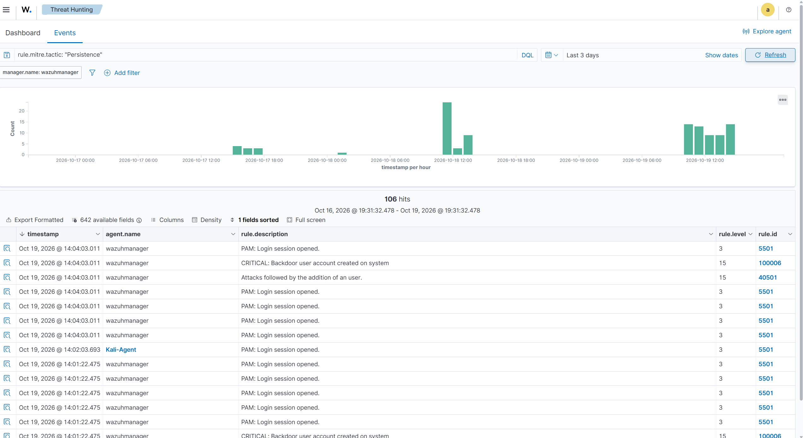
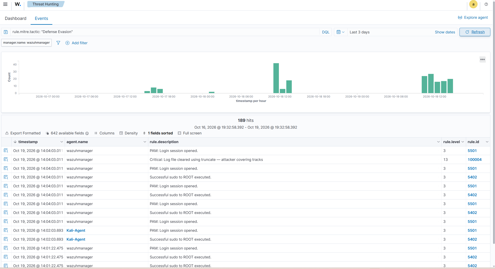

# Threat Hunting

Three structured hunts were run after the simulation using the Wazuh Threat Hunting module. The purpose wasn't to find new alerts — the simulation was already documented. The hunts were about validating that the detection layer caught what it was supposed to catch, and confirming the scope of each attack stage using DQL queries against the raw indexer data rather than relying on dashboard summaries.

All queries were run with a `manager.name: wazuhmanager` filter applied.

---

## Hunt 1 — Brute Force Scope

**Question:** How much authentication traffic did the Hydra attack actually generate, and did any attempt succeed?

```
data.srcip: "192.168.56.103" AND rule.groups: "authentication_failed"
```

**Time window:** Last 7 days  
**Result:** 173,703 hits

The dashboard broke it down cleanly: 173,703 total events, 173,703 authentication failures, 0 level 12+ alerts, 0 successful authentications. Every single attempt failed. The MITRE breakdown showed Password Guessing, SSH, and Brute Force as the top three technique tags — all correct for Hydra against SSH. The alert level evolution chart confirmed the attack was concentrated on October 18, with the spike appearing as a near-vertical rise around 12:00 UTC.

Filtering exclusively to source IP 192.168.56.103 confirmed all 173,703 failures came from the Kali machine — no noise from other sources in the result set.


---

## Hunt 2 — Persistence Validation

**Question:** Did Wazuh capture the backdoor user creation, and did custom Rule 100006 fire as expected?

```
rule.mitre.tactic: "Persistence"
```

**Time window:** Last 3 days  
**Result:** 106 hits

Scrolling the event list confirmed Rule 100006 ("CRITICAL: Backdoor user account created on system", level 15) firing alongside Rule 40501 ("Attacks followed by the addition of an user", level 15). Both fired at the same timestamp — Oct 19 @ 14:04:03 — which corresponds to the `useradd` command run during the persistence stage. The timeline showed two clusters of activity: a smaller group around Oct 18 12:00 and a larger burst on Oct 19, matching the sequence of the simulation.

The 106 hits include the cron job FIM alerts and PAM session events that Wazuh maps to Persistence — not just the backdoor user. The rule 100006 hits were the most significant, confirming the custom rule validated correctly against real attack activity.



---

## Hunt 3 — Defense Evasion Confirmation

**Question:** Was the log clearing detected, and did Rule 100004 fire on both truncate commands?

```
rule.mitre.tactic: "Defense Evasion"
```

**Time window:** Last 3 days  
**Result:** 189 hits

Rule 100004 ("Critical: Log file cleared using truncate — attacker covering tracks", level 13) was visible in the event list at Oct 19 @ 14:04:03, firing alongside the sudo session events. The 189-hit total is higher than expected from the two truncate commands alone — the Defense Evasion tactic bucket in Wazuh also picks up T1562.001 (agent stop/start events) and T1078 (valid account usage), which contributed the bulk of the count.

The key confirmation: Rule 100004 appeared in the results, and the full_log captured the exact truncate command and target file from journald — confirming the detection worked even though the log files themselves had been wiped.



---

## Summary

| **Hunt** | **Query** | **Hits** | **Key Confirmation** |
|----------|-----------|----------|----------------------|
| Brute Force | `data.srcip: "192.168.56.103" AND rule.groups: "authentication_failed"` | 173,703 | 0 successful authentications — attack fully contained |
| Persistence | `rule.mitre.tactic: "Persistence"` | 106 | Rule 100006 fired — backdoor user captured |
| Defense Evasion | `rule.mitre.tactic: "Defense Evasion"` | 189 | Rule 100004 fired — log clearing captured via journald |
